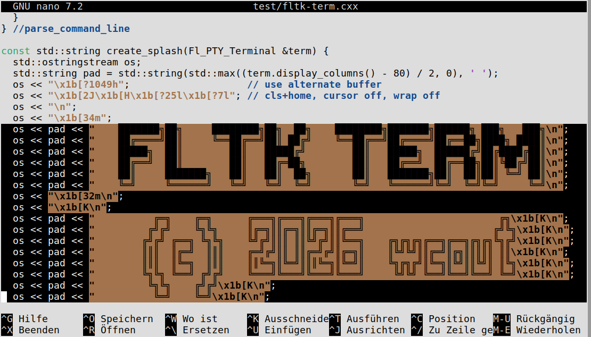

# FLTK PTY-TERMINAL WIDGET

*&nbsp;&nbsp;fltk-term running nano editor with text selected*

This is an extension for FLTK's `Fl_Terminal` widget, in form of a derived class
`Fl_PTY_Terminal`, to run an interactive terminal shell with it. Code is designed
to be cross-platform, but tested only on Linux and WIN11, Apple status is unknown.

However, the original Fl\_Terminal\_Widget's ANSI capability is missing
several important features (like alternate buffer, scroll region, mouse report,..)
in order to run "real" terminal applications (like vim, btop,..) with it.
These additions have been carefully crafted **into** the original widget in order
not to create a full rewrite of an FLTK ANSI-Terminal class.

See [CHANGES_FL_TERMINAL.md](CHANGES_FL_TERMINAL.md)

## Contents

### Extended Fl\_Terminal

  - `FL/Fl_Terminal.H`
  - `src/Fl_Terminal.cxx`

The modified, fully API backwards compatible FLTK `Fl_Terminal`
widget, which you could copy verbatim into an existing FLTK source tree.

### PTY support Widget Fl\_PTY\_Terminal

  - `FL/Fl_PTY_Terminal.h`
  - `src/FL_PTY_Terminal.cxx`

A widget derived from the extended Fl_Terminal widget, which handles
the pseudo terminal (bash, cmd.exe, zshell integration) setup in a
platform independent way.

### Test programs

Two test programs show the use of the Fl\_PTY\_Widget.

  - `test/fltk-term`

A fully working ANSI terminal for the desktop. Tested to work on several Linux flavours and Windows 11.

  - `test/fltk-term-tabbed`

A showcase for putting multiple Fl\_PYT\_Terminal's into a tabbed interface.

---

In both programs the background color can be changed with the `F12` key
and `Alt-F12` switches between 2 color palettes.

Screen size and font settings are stored in a user FLTK preferences file.

## LICENSE

The extended `Fl_Terminal` widget keeps the FLTK license [COPYING](COPYING).
The derived `Fl_PTY_Terminal` widgets and the test programs are GPL [LICENSE](LICENSE).

